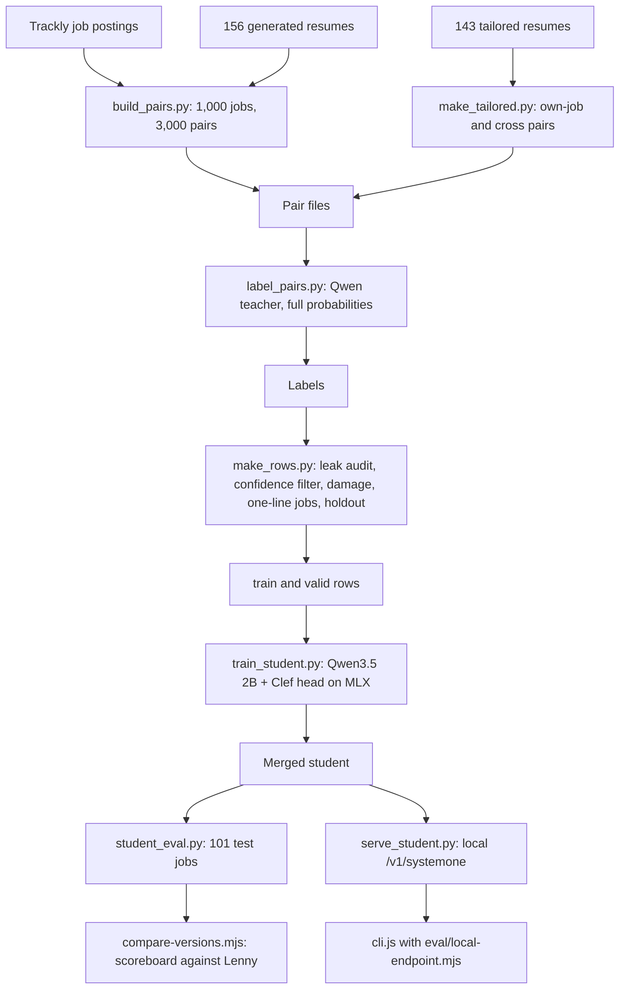

# feat: Train and grade the student decision model

## Summary

Finish the training data and train a small student model on the Mac. Then grade it on the 101 test jobs with the scoreboard used for Jev and the teacher. Then try it from the CLI through a local endpoint, and decide the next step against thresholds written down before the numbers exist.

---

## Problem Frame

Worth Applying? scores job fit by calling TypeSafe's Jev, which needs a paid API key. The `model/` project asks whether a small open model can answer the same nine questions closely enough to run without one. A local Qwen 3.8 27B teacher tied Jev on the 101-job test, so its answers are worth learning from.

Most of the training data now exists. There are 156 generated resumes, 143 resumes written for specific postings, 1,000 Trackly jobs and 3,286 resume and job pairs. A blind Opus 5.5 judge agreed with the teacher within one point on 88% of 120 pairs. The same check showed that strong matches are rare in the generated pairs, which is why the 143 tailored resumes exist.

This is a learning project. The plan favors small, observable steps over production hardening, and each step ends with a lesson in `model/LEARNING.md`.

---

## Requirements

**Data**
- R1. The teacher labels at least 95% of the pairs in the three pair files with its full probabilities. One prompt version covers all of them.
- R2. No test job, or text taken from one, reaches a training or validation row.
- R3. Training rows match what the extension sends. The state and questions come from `scoring.js`. Most job descriptions arrive as one line, as `extract.js` sends them. Most rows carry no company, since 104 of the 109 test jobs had none. URLs carry no query string, and the visa question appears only in pairs that ask it.
- R4. The training rows cover the whole fit range, with enough 3s and 4s to learn from.

**Training**
- R5. The student trains on the Mac in the pinned environment, reproducibly from the repo and the private data.
- R6. Validation measures both new jobs and new resumes, and training stops if more than 2% of answers can't be read.

**Grading and trying**
- R7. The student is graded on the 101 test jobs with the same cross-validated method as Jev and the teacher, and its speed is reported.
- R8. The student can be tried from the CLI without changing anything the Chrome Web Store build ships. The real resume never leaves the Mac.

**Hygiene**
- R9. Nothing under `model/private/` or `eval/private/` is committed, and each step adds a lesson to `model/LEARNING.md` with aggregate numbers only.
- R10. New code is reviewed, and the review's open findings are decided before the next long run.

---

## Key Technical Decisions

- **Student: Qwen3.5 2B with a Clef joint head.** It reads a whole resume and posting, which Laya's 1,024-token limit can't. It is Apache 2.0, and Unsloth's MLX trainer supports it on Apple Silicon. The 0.8B would be faster but reads long postings less well. The 4B is the fallback if the 2B can't learn the teacher. Clef is Unsloth's name for the joint head design, and Cloudflare's released Clef models use the same design on bigger Qwen backbones.
- **Soft labels.** The gold answers are the teacher's full probabilities, not its top pick. The extension's scores are probability-weighted, so the student needs the teacher's doubt as well. Hard labels would teach "1" for a pair the teacher split 55/40 between 1 and 0. Unsloth's converter accepts `{label, probabilities}`.
- **Confidence calibration is separate from score mapping.** Unsloth's `calibrate()` fits temperatures to the teacher's top answers after training, and the run records them. That differs from the score mapping in U5, which converts raw fit onto Lenny's 1 to 10 scale. The adapters from before calibration are kept, so an uncalibrated grade stays possible.
- **Pinned environment.** `model/.venv-train` copies the Unsloth app's exact package versions from `model/requirements-train.txt`, on Python 3.13. The app updates itself, and the copy doesn't.
- **Settings from Unsloth's guide.** LoRA rank 16, batch 2 with 4 accumulation steps, 2 epochs, learning rate 2e-4 and a cosine schedule. A 6,144-token limit covers the longest teacher prompt (4,796 tokens) plus the questions. These are first-run defaults, and tuning waits for the first scoreboard.
- **Training runs over the 16-bit base.** The merged model is always 16-bit. In a smoke run, adapters trained over a 4-bit copy answered up to 0.13 differently once merged. 16-bit training ran no slower, so the trained, graded and served models are one model. `--four-bit` remains as an option.
- **Validation by hash.** A stable tenth of jobs and a tenth of resumes, with all their pairs, never enter training. The split doesn't change between runs.
- **The text looks like the extension's.** Damage changes resume formatting but keeps the clean label. Most job descriptions are collapsed to one line, because every test job arrives that way from `extract.js`. Most rows also leave the company out, because `extract.js` finds one on few sites.
- **Two layers of leak protection.** `build_pairs.py` chose the jobs. `make_rows.py` then runs a stricter audit, with decoded text, overlap measured against both postings, and every company and title spelling. Its audit drops anything that slipped through, without reshuffling the labeling run. A tailored resume goes wherever its source posting goes, into validation or out of every row.
- **The Opus judge only measures.** Its answers never become labels or select data. That keeps Claude's output out of training targets.
- **Trying it through a preload, locally only.** A script in `eval/` sends the CLI's one TypeSafe call to `model/serve_student.py`, which serves the merged student at `/v1/systemone` on 127.0.0.1. The Unsloth app was the first choice, but it serves Clef models only on NVIDIA or AMD GPUs. `eval/` never ships, and `scoring.js`, `manifest.json` and the store build stay untouched. Editing the endpoint constant, as the README's model-swap recipe does, would touch files in the pending 1.5.0 release.

---

## High-Level Technical Design

The data flows one way, from postings and resumes to a graded model:

The decision is set before the numbers exist. "Gap" means the mean absolute gap from Lenny's scores of the student's shipping method (`XG2`), as `compare-versions.mjs` prints it, never the signed "Avg gap" column. Jev's is 0.59 and the teacher's 0.63. "Agreement" means rank agreement between the student's and the teacher's raw fit.

| Result | Reading | Next step |
|---|---|---|
| Gap 0.74 or less, and the difference interval against Jev includes zero | Close enough | Confirm with a second training seed, then plan how a local option could ship |
| The student beats Jev with an interval that excludes zero | Too good to trust yet | Repeat with a second seed before believing it |
| Gap 0.75 to 0.95, with agreement of 0.8 or more on validation rows but under 0.7 on the test jobs | It learned the teacher on synthetic text but not on a real resume | Fix the gap between training and real text before scaling |
| Gap 0.75 to 0.95, with low agreement on both | It didn't learn enough | Longer training first, then the 4B student, then more data |
| Gap above 0.95 | Something is broken | Check rows, labels and the reload before any retraining |

A row for "the teacher is the ceiling" was considered and dropped. The teacher tied Jev, so a student close to the teacher is close to Jev too.

---

## Implementation Units

### U1. Settle the code review findings

**Goal:** Decide and apply the open findings from the code review of the pipeline scripts, before the next long run.

**Requirements:** R2, R9, R10

**Dependencies:** None

**Files:**
- Modify: `model/build_pairs.py`, `model/make_resumes.py`, `model/label_pairs.py`, `scripts/package.mjs`
- Test: `model/tests/test_pipeline.py`, `test/package.test.mjs`, `test/private-paths.test.mjs`

**Approach:**
- Already applied:
  - `label_pairs.py` gained a lock, per-pair skip and log, and correct `--limit 0`. It no longer loads the model with nothing to do, and it reads several pair files with a resume folder per pair.
  - The name check covers every resume, and the length band uses whole numbers.
  - `model/tests/test_pipeline.py` runs with `npm run test:model`.
  - `test/private-paths.test.mjs` fails `npm test` if a private path is ever tracked or stops being ignored by the repo's own `.gitignore`.
  - The two resume checks share one contact rule and report unwritten or unknown ids. The cross pairs refuse a rewrite once they have labels.
  - The packager test pins that files under `model/private` can never ship.
  - `build_pairs.py` refuses to run without test jobs, and refuses to rewrite pairs that have labels.
  - The contact rule checks each link and phone number on its own.
  - Every label carries a prompt stamp and its teacher. The rows script checks them against today's prompt, and training checks the rows against their manifest.
- Changes to code the teacher imports land only between labeling runs.

**Patterns to follow:** the `check(name, ok)` style in `test/*.test.mjs`, and `model/tests/test_pipeline.py` (standard library `unittest`) for Python.

**Test scenarios:**
- `build_pairs.py` with an empty test folder exits with a message and writes nothing.
- `build_pairs.py` with existing labels and a changed pair set exits unless `--force` is passed.
- The contact check flags a LinkedIn URL on the email line, a `www.` link and a phone number without 555. It passes example.com links and local formats such as +54 11 5555 0178.
- The packager refuses a build that lists `model/train_student.py`.
- A file force-added under `model/private/` makes `npm test` fail.

**Verification:** `npm test` and `npm run test:model` pass, and each finding is marked applied or declined.

---

### U2. Finish labeling and check the score spread

**Goal:** Label at least 95% of the 3,286 pairs, then confirm the training rows cover the whole fit range.

**Requirements:** R1, R4, R9

**Dependencies:** None. Labeling began on 2026-10-16, before U1. No code the teacher imports changed after the first label was written, so every label shares one prompt version.

**Files:**
- Use: `model/label_pairs.py`, `model/make_rows.py`
- Modify: `model/LEARNING.md`

**Approach:**
- Already written: one run labels the tailored pairs, then the cross pairs, then the remaining main pairs, so the strong-match answers arrive first. A second run retries any pair that failed.
- Read the spread from the report `make_rows.py` prints, counting training rows only.
- The bar, set before looking: at least 80 training rows whose top answer is 3 or 4, and at least 240 at 2.
- If the bar is missed, write a second tailored batch. Giving fewer 0-answer rows to training changes the mix but not these counts, so it only helps if the student over-predicts 0.

**Test scenarios:**
- With every pair labeled, `label_pairs.py` prints its counts and exits without loading the model.
- A pair whose resume file is missing is reported as waiting, then labeled on a later run once the file exists.
- Five failures in a row stop the run with a message, so a restart reloads the model.

**Verification:** At least 95% of pairs have labels, the spread meets the bar or the second batch is underway, and a lesson records the spread.

---

### U3. Build the training rows

**Goal:** Write `train.jsonl` and `valid.jsonl` from the labels.

**Requirements:** R2, R3, R4, R6, R9

**Dependencies:** U2

**Files:**
- Modify: `model/make_rows.py`, `model/LEARNING.md`
- Test: `model/tests/test_pipeline.py`

**Approach:** The leak audit drops flagged jobs from every row, and a tailored resume goes wherever its source posting goes. The confidence filter drops a whole row when a non-visa answer's allowed options held under 90% of the teacher's probability. It removes only the visa answer when its options held under 50%, and a missing or NaN mass counts as unclear. Damage applies to marked pairs. 80% of job descriptions are collapsed to one line, 95% of rows leave out the company, and URLs lose their query strings. Holdout splits by job and by resume, and a fixed seed shuffles the rows. A spread report of training rows by pair type ends the run. The build stops on a missing or under-labeled pair file, a missing test folder, or any overlap with the real resume.

**Test scenarios:**
- `gold_for` maps the teacher's probabilities to the trainer's keys, and visa becomes true or false.
- A job whose text matches a test job only after decoding `&amp;` is flagged by the audit.
- A test job's text copied into a much longer posting is flagged, because overlap is measured against both texts.
- A row whose fit answer held under 90% of the teacher's probability is dropped. A visa answer under 50% is removed, and the row stays.
- A damaged or one-line state differs from the clean one, and its gold answers equal the clean pair's.
- A URL with a query string reaches the state without it.
- A tailored resume whose source posting is held out goes to validation with all its pairs.
- A missing or NaN option mass drops the row.

**Verification:** The audit leaves out every flagged job, and no training resume shares a 13-word run with the real test resume. Coverage is at least 95%, and a lesson records the row counts.

---

### U4. Smoke-test, then train the student

**Goal:** A trained student, saved as adapters and as a merged model, whose reloaded answers match the trained ones.

**Requirements:** R5, R6, R9, R10

**Dependencies:** U3

**Files:**
- Modify: `model/train_student.py`, `model/student_eval.py`, `model/README.md`, `model/LEARNING.md`
- Test: `model/tests/test_pipeline.py`

**Approach:**
- Already written:
  - `train_student.py` has `--smoke`, `--steps`, `--name` and `--resume`, plus the 2% skip stop. It refuses to start while the teacher is labeling.
  - The smoke run saves and evaluates every 10 steps, and a second smoke command resumes it. The full run's checkpoint and resume paths get tried first.
  - It saves the adapters before calibrating and keeps that copy, then writes the calibrated merged model.
  - It records the temperatures and saves three validation answers, with their inputs, to `preview.json`.
  - `student_eval.py --check-reload` reloads the merged model and fails if any probability moved by more than 0.02 or came back NaN.
  - `model/README.md` has the environment recipe.
- Before the full run, review the new scripts (`make_rows.py`, `make_tailored.py`, `train_student.py` and `student_eval.py`) and decide their findings.
- The smoke run (20 steps on 64 rows) runs after labeling ends, never beside it. The full run waits for the user's go, since it ties up the Mac for hours. The smoke run's step time sets its time estimate.

**Test scenarios:**
- The smoke run saves adapters, a merged model and `preview.json`, and `--check-reload` passes on it.
- A smoke run with `--resume --steps 24` continues from step 20.
- A dataset where more than 2% of answers are skipped stops before training.
- A full run with an existing `--name` exits unless `--resume` is passed.

**Verification:** The run's `summary.json` holds the held-out metrics and temperatures, `--check-reload` passes, and a lesson records the run.

---

### U5. Grade the student

**Goal:** The student on the same scoreboard as Jev and the teacher, read against the decision table.

**Requirements:** R7, R9

**Dependencies:** U4

**Files:**
- Modify: `model/student_eval.py`, `model/LEARNING.md`
- Create: `model/agreement.py`
- Use: `eval/compare-versions.mjs`
- Test: `model/tests/test_pipeline.py`

**Approach:**
- `student_eval.py` writes results in the shape Jev's results use, into a folder named after the run. It refuses to mix two models' results in one folder.
- `compare-versions.mjs --extra` grades them with cross-validated score mapping.
- Read the student's `XG2` mean absolute gap and its interval against Jev's `G2`, plus time per job.
- `model/agreement.py` prints the student's rank agreement with the teacher's raw fit on the validation rows and on the 101 test jobs. Those are the two numbers the decision table needs.

**Test scenarios:**
- Every result file holds all six scorecard dimensions. `compare-versions.mjs` silently treats a missing one as 1, so the writer must never omit one.
- `agreement.py` returns 1.0 for identical fits and handles ties without dividing by zero.
- A new run name writes a new results folder instead of reusing old ones.

**Verification:** A version comparison for the run exists in the private analysis folder, the agreement numbers are printed, and a lesson records the scoreboard.

---

### U6. Try the student from the CLI

**Goal:** Score a posting with the student through the same request the extension sends, with every byte staying on the Mac.

**Requirements:** R8, R9

**Dependencies:** U4

**Files:**
- Create: `eval/local-endpoint.mjs`, `model/serve_student.py`, `model/serve_check.py`
- Modify: `model/README.md`, `model/LEARNING.md`, `package.json`
- Test: `test/local-endpoint.test.mjs`, `model/tests/test_pipeline.py`

**Approach:**
- The Unsloth app was the first plan, and it can't serve the student on a Mac. It answers that Clef models need an NVIDIA or AMD GPU. So `model/serve_student.py` loads the merged model with `student_eval.py`'s loader and answers `/v1/systemone` on 127.0.0.1:8899. It answers only to the student's exact name, only when addressed as 127.0.0.1, and only to JSON bodies under 2 MB. A 200 answer carries the local-backend header, and no reply or log quotes the resume.
- The preload sends the CLI's one scoring call there and names the student exactly. Inside the app, a default alias such as `jev-latest` can resolve to a hosted model. The header check only reads the answer, after the resume has gone. The preload sets `TYPESAFE_API_KEY` to `no-key-required`, so the real key is never read. It refuses any other request, redirects, a proxy setting and any address but 127.0.0.1. It retries a 503 while a model loads.
- `model/serve_check.py` sends the run's `preview.json` rows, all generated resumes, and fails unless every probability comes back within 0.02 of the trained answers. A made-up resume then goes through the CLI. The real resume goes through only after both.
- On an NVIDIA or AMD machine, the app can serve the student instead, through `LOCAL_DECISION_URL` and a `clef-ft:` name. That route is untested.

**Test scenarios:**
- With the preload and a stub server, `cli.js` sends the nine-question request to the local URL with `Bearer no-key-required`, naming the student exactly. The stub sees neither of two sentinel values planted in `TYPESAFE_API_KEY` and `~/.typesafe_api_key`.
- A stub answer without the local-backend header makes the preload fail.
- Look-alike hosts, `localhost`, `127.1`, a proxy setting and a default alias as the model name are refused before anything is sent. A redirect is refused, and its target sees nothing.
- A 503 while the model loads is retried, and one that never ends becomes an error.
- The student server listens on 127.0.0.1 only. It refuses another model name, another host name, a non-JSON body and an empty or oversized one, and none of them reach the model.
- A model error's reply and log quote nothing from the request.
- `serve_check.py` passes on matching answers, including a one-number visa answer. It fails on a drifted answer, an answer without the local-backend header, or nothing to compare.
- The server, the preload and `serve_check.py` agree on the student's name and port.
- Without the preload, `cli.js` still calls TypeSafe.

**Verification:** `serve_check.py` passes against the running server. A made-up resume and then the real resume are scored end to end through the CLI. The CLI's report shows the answer, so `parseJevResponse` in `scoring.js` accepted it, and a lesson records the trial.

---

### U7. Record the result and decide what's next

**Goal:** A written decision, made against the decision table above.

**Requirements:** R9

**Dependencies:** U5

**Files:**
- Modify: `model/LEARNING.md`, `model/README.md`

**Approach:** Find the matching row, and run its next step if it is a confirmation (the second seed). Then write a lesson with the numbers, the row and the decision.

**Test expectation:** none. This unit writes documentation only.

**Verification:** `model/LEARNING.md` has a lesson with the scoreboard, the row and the decision.

---

## Scope Boundaries

- No shipping of the student in the store extension and no hosting it anywhere. How to ship comes after U7.
- No change to the extension's questions or rubric, including the role-level wording the judge flagged. A change there needs a `SCORING_CACHE_VERSION` bump and a new teacher run.
- No ResumeAtlas or other outside resume data (lesson 9).

### Deferred to Follow-Up Work

- A written, validated judge answer format, and future judge runs staged outside the repo with opaque case ids.
- Shared loaders across the scripts, and a `teacher_eval.py` that imports without MLX.
- Measuring the damage directly: the teacher labels about 50 damaged copies, and the 101 jobs are scored with a damaged test resume.
- A zero-shot grade of a released Clef model on the 101 jobs, as a fourth scoreboard row.
- A per-function look at the teacher's harshness, since one score mapping can't absorb a bias that differs by function.
- A scan of postings for instruction-like text, since posting text flows into the teacher's prompt.

---

## Risks & Dependencies

| Risk | Mitigation |
|---|---|
| Labeling stops overnight from sleep or a GPU error | `caffeinate`, per-pair skip and log, restartable runs, a retry loop and a watched rerun |
| The MLX trainer differs from Unsloth's GPU guide | The smoke run and the reload check come before the full run |
| Too few strong matches | Tailored and cross pairs, plus U2's spread bar and its second-batch lever |
| The student learns "written for this posting" as fit | Cross pairs put each tailored resume against a different job |
| Training text differs from test text | One-line job descriptions, decoded entities and URLs without query strings in rows |
| The 101-job test is noisy around a 0.15 margin | A pass is confirmed with a second training seed before any shipping plan |
| The resume reaches a hosted model during the CLI trial | The student's exact name in every request, a server that answers only to it on 127.0.0.1, and generated resumes before the real one |
| Private data reaches git | `test/private-paths.test.mjs` in `npm test`, and aggregate numbers only in the docs |
| Memory pressure | The teacher and the student never run at the same time |

---

## Assumptions

These are bets made without the user's confirmation, while the user was asleep:

- Two epochs over about 2,600 training rows is enough for a first student. That's what remains after the holdout and the filters. The smoke run's speed decides whether a full run fits in a night.
- The teacher's harshness is mostly a steady offset that score mapping absorbs. It is larger in finance and partnerships, which one mapping can't fully absorb.
- 143 tailored resumes and their cross pairs give enough 3s and 4s. U2's bar checks this.
- The Unsloth app serves a merged Clef model through `/v1/systemone` with the answer shape `parseJevResponse` expects. This was wrong on a Mac, where the app serves Clef models only on NVIDIA or AMD GPUs. `model/serve_student.py` took its place (U6).
- A 6,144-token limit covers nearly all training prompts.

---

## Sources & Research

- `model/LEARNING.md`, lessons 1 to 11: the teacher check, data decisions and the judge.
- Unsloth's decision-model guide: https://unsloth.ai/docs/basics/train-your-own-decision-model-with-unsloth
- Unsloth 2026.10.6's MLX path in `unsloth/models/decision_mlx.py` and `_decision_common.py` (soft-label gold, Clef saving and merging), and the app's keyless-access rules in `studio/backend/utils/keyless_api_access.py`.
- Anthropic on training with Claude's outputs: https://support.claude.com/en/articles/12326764-can-i-use-my-outputs-to-train-an-ai-model
- `docs/solutions/conventions/package-chrome-extension-from-allowlist-never-zip-repo-root.md` and `docs/solutions/workflow-issues/check-generated-data-as-a-set-and-assign-unique-names-in-code.md`
